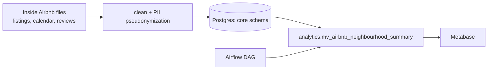

# Airbnb Ops Platform

A small, production-minded data platform built around public Airbnb data: reproducible
ingestion, PII handling, validated analytics, SQL performance tuning, and (in later
milestones) scheduled orchestration and dashboards.

## Status

| Milestone | Scope | State |
|---|---|---|
| 1. Package and ingestion | CLI, PII handling, cleaning, Postgres loader, tests, CI, Docker | done |
| 2. SQL performance | baseline query, `EXPLAIN ANALYZE`, materialized view, indexes, benchmark | done |
| 2b. Dashboard | Metabase on the materialized view | planned |
| 3. Orchestration | Airflow DAG: refresh, validate, branch, report | planned |

## Architecture



## Quickstart

```bash
make install            # editable install with db + dev extras
make test               # unit tests (database tests are skipped)

make db-up              # Postgres 16 via docker compose
# place Munich files in data/raw/munich/ (see the README there), then:
make ingest

make test-db            # full tests incl. database ones (separate airbnb_test database)
make perf               # EXPLAIN ANALYZE + benchmark -> reports/sql_performance.md
```

Tiny demo pipeline on the bundled CSVs (no database needed):

```bash
airbnb-ops run          # writes data/processed/... and reports/hw01_a_run_report.md
```

## SQL performance

`make perf` measures three ways of producing the neighbourhood summary on the Munich snapshot
and writes `reports/sql_performance.md`, `reports/baseline_explain_analyze.txt` (the plan) and
compares them. `reports/explain_notes.md` explains what the plan shows.

- **Naive join** of listings, calendar and reviews: slow, and also wrong. Joining tables of
  different grain repeats rows, so `AVG(price)` is weighted by review counts.
- **Baseline**: CTEs aggregate to listing grain first. Correct, but it re-reads millions of
  calendar rows to produce 25 result rows.
- **Materialized view** `analytics.mv_airbnb_neighbourhood_summary` with a unique index (for
  `REFRESH ... CONCURRENTLY`) and a `num_listings` index. Dashboards only read this.

A test asserts the view returns exactly the same numbers as the baseline.

## Design decisions

- **PII never enters the warehouse.** Only needed columns are read (names and free text such
  as `comments` are never loaded). `host_id` and `reviewer_id` become salted SHA-256 keys.
- **Bulk loading uses `COPY`**, in chunks for the calendar table. A full Munich snapshot
  (about 2.7M calendar rows) loads in roughly 30 seconds.
- **Cleaning is pure functions**, so it is unit-tested without a database. Real quirks handled:
  prices stored as text (`"$1,250.00"`), about a third of prices missing, duplicate review ids.
- **Config comes from the environment**; no secrets in the repo. See `.env.example`.
- **`core` has primary keys only.** Performance work is a separate, measured step, and derived
  objects live in the `analytics` schema, never in `core`.
- **SQL lives in the package** (`src/airbnb_ops/sql/`) as the single source of truth for the
  CLI, tests and the future Airflow DAG. A test rejects `SELECT *`.
- **Integration tests use their own database** (`airbnb_test`), so they cannot touch loaded data.

## Data and attribution

Data: [Inside Airbnb](https://insideairbnb.com/get-the-data/), licensed
[CC BY 4.0](https://creativecommons.org/licenses/by/4.0/). Munich snapshot dated 23 September
2026. Test fixtures are a small anonymized slice of the Albany snapshot (16 September 2026).
Raw city files are not committed.

## Layout

```
src/airbnb_ops/   package (cli, pii, transform, validate, analytics, ingest/)
src/airbnb_ops/sql/  core schema, baseline query, materialized view
tests/            unit tests + fixtures (database tests need Postgres)
reports/          generated performance reports and plan notes
dags/             Airflow DAGs (milestone 3)
notebooks/        thin walkthroughs that import from the package
```
