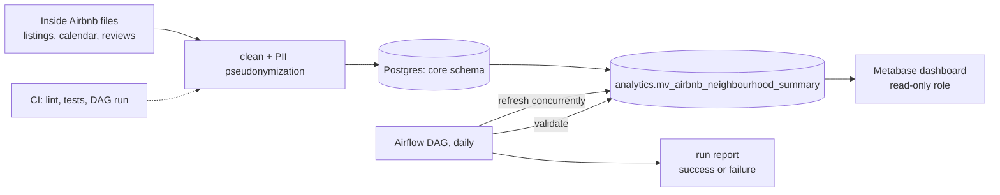
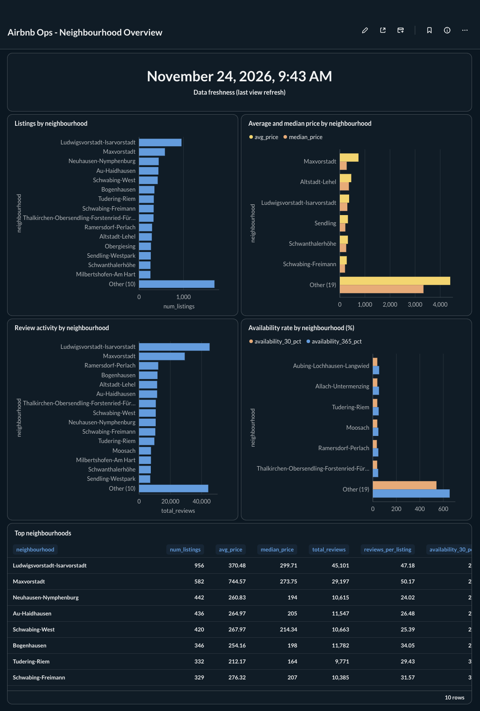

# Airbnb Ops Platform

[](https://github.com/mbsoroush/Airbnb-Ops-Platform/actions/workflows/ci.yml)

A small, production-minded data platform built around public Airbnb data: reproducible
ingestion, PII handling, validated analytics, SQL performance tuning, a dashboard defined as
code, and scheduled orchestration with Airflow.

## Status

| Milestone | Scope | State |
|---|---|---|
| 1. Package and ingestion | CLI, PII handling, cleaning, Postgres loader, tests, CI, Docker | done |
| 2. SQL performance | baseline query, `EXPLAIN ANALYZE`, materialized view, indexes, benchmark | done |
| 2b. Dashboard | Metabase on the materialized view, provisioned from code | done |
| 3. Orchestration | Airflow DAG: refresh, validate, branch, report | done |

## Architecture



## Quickstart

```bash
make install            # editable install with db + dev extras
make test               # unit tests (database tests are skipped)

make db-up              # Postgres 16 via docker compose
# place Munich files in data/raw/munich/ (see the README there), then:
make ingest

make test-db            # full tests incl. database ones (separate airbnb_test database)
make perf               # EXPLAIN ANALYZE + benchmark -> reports/sql_performance.md

make view               # (re)build the materialized view the dashboard reads
cp .env.example .env    # then set AIRBNB_READER_PASSWORD and METABASE_ADMIN_PASSWORD
make bi-up              # Metabase on http://localhost:3000 (first start takes a minute or two)
make bi-setup           # read-only DB role + Metabase admin, connection and dashboard
```

Tiny demo pipeline on the bundled CSVs (no database needed):

```bash
airbnb-ops run          # writes data/processed/... and reports/hw01_a_run_report.md
```

## SQL performance

`make perf` measures three ways of producing the neighbourhood summary on the Munich snapshot
and writes `reports/sql_performance.md`, `reports/baseline_explain_analyze.txt` (the plan) and
compares them. `reports/explain_notes.md` explains what the plan shows.

- **Naive join** of listings, calendar and reviews: slow, and also wrong. Joining tables of
  different grain repeats rows, so `AVG(price)` is weighted by review counts.
- **Baseline**: CTEs aggregate to listing grain first. Correct, but it re-reads millions of
  calendar rows to produce 25 result rows.
- **Materialized view** `analytics.mv_airbnb_neighbourhood_summary` with a unique index (for
  `REFRESH ... CONCURRENTLY`) and a `num_listings` index. Dashboards only read this.

A test asserts the view returns exactly the same numbers as the baseline.

## Dashboard (Metabase)



The dashboard is defined as data in `src/airbnb_ops/metabase/dashboard.py` and provisioned
through Metabase's REST API by `airbnb-ops metabase-setup` (run by `make bi-setup`):

- **Cards:** listings, average/median price, review activity and availability by
  neighbourhood, a top-10 table, and a data-freshness tile. Every card is a SQL query on
  `analytics.mv_airbnb_neighbourhood_summary`, so opening the dashboard never runs a big join.
- **Idempotent:** objects are found by name and updated in place. Edit the file, run
  `make bi-setup` again, and Metabase converges to what is in code.
- **Least privilege:** Metabase connects as `metabase_reader`, a role that can read only the
  `analytics` schema (`airbnb-ops create-reader`). Default privileges keep that access when
  the view is rebuilt. It cannot read `core` or create anything.
- **Secrets** come from `.env` (gitignored): `METABASE_ADMIN_PASSWORD`,
  `AIRBNB_READER_PASSWORD`. Nothing secret is committed.
- `airbnb-ops metabase-setup --dry-run` prints the full dashboard definition without calling
  Metabase. The image is pinned in `docker-compose.yml` (override with `METABASE_VERSION`).

**Data-quality note:** some listings have extreme prices (two private rooms above 68,000 per
night), so neighbourhood averages can be badly skewed. The price card shows the median next to
the average for that reason. About a third of Munich listings have no price at all.

**Manual fallback:** Metabase's API changes between versions. If automated setup ever fails,
add the database in the Metabase UI with the reader credentials and create each question as
a native query using the SQL from `--dry-run`.

The Metabase app database is a local H2 file in a Docker volume, which is fine for development;
production should use Postgres for it.

## Orchestration (Airflow)

DAG `airbnb_neighbourhood_summary` (`dags/`) runs daily at 03:00 UTC:

```
read_config -> refresh_summary -> validate_summary -> choose_report_path -> write_success_report
                                                                         \-> write_failure_report
```

- **Thin DAG, tested logic.** All behaviour lives in `src/airbnb_ops/pipeline.py`, which needs
  only a tiny `SqlRunner` protocol. Airflow supplies a `PostgresHook` adapter; tests use a fake
  runner or a real Postgres. The module imports neither pandas nor SQLAlchemy.
- **Refresh** uses `REFRESH MATERIALIZED VIEW CONCURRENTLY` (readers are never blocked), creates
  the view if missing, and rebuilds it with the `rebuild` run parameter after the SQL changes.
- **Validation** (`sql/03_validate_summary.sql`): *error* checks fail the run (empty view, null
  neighbourhoods, negative prices, availability outside 0..1, view not reconciling with `core`);
  *warn* checks are reported only (price outliers above a threshold, share of listings with no
  price).
- **Branching:** a markdown report is written to `reports/airflow_runs/` either way. On failure
  the report is written first and then the task raises, so the run is red in the UI *and*
  leaves evidence.
- **Config, no secrets in code:** Connection `airbnb_warehouse` (env `AIRFLOW_CONN_*`) and
  Variables `airbnb_reports_dir`, `airbnb_price_outlier_threshold`, `airbnb_max_null_price_share`.
- **Settings:** `catchup=False`, `max_active_runs=1`, retries on data tasks, none on the report.

```bash
make db-up && make ingest && make view     # data and view must exist
# set AIRFLOW_ADMIN_PASSWORD in .env, then:
make af-up                                  # http://localhost:8080, user: admin
make af-trigger                             # unpause + trigger; see reports/airflow_runs/
```

**Dev-only caveat:** the container runs `airflow standalone` (SQLite metadata DB, one process,
SimpleAuthManager with a plaintext password file). Production would use the official multi-service
deployment, a Postgres metadata DB, and a real auth manager. The Airflow version is pinned
(`AIRFLOW_VERSION`, default 3.4.0); CI installs it with the official constraints file and runs the
DAG end to end on the small fixture city.

## Design decisions

- **PII never enters the warehouse.** Only needed columns are read (names and free text such
  as `comments` are never loaded). `host_id` and `reviewer_id` become salted SHA-256 keys.
- **Bulk loading uses `COPY`**, in chunks for the calendar table. A full Munich snapshot
  (about 2.7M calendar rows) loads in roughly 30 seconds.
- **Cleaning is pure functions**, so it is unit-tested without a database. Real quirks handled:
  prices stored as text (`"$1,250.00"`), about a third of prices missing, duplicate review ids.
- **Config comes from the environment**; no secrets in the repo. See `.env.example`.
- **`core` has primary keys only.** Performance work is a separate, measured step, and derived
  objects live in the `analytics` schema, never in `core`.
- **SQL lives in the package** (`src/airbnb_ops/sql/`) as the single source of truth for the
  CLI, tests and the Airflow DAG. A test rejects `SELECT *`.
- **Integration tests use their own database** (`airbnb_test`), so they cannot touch loaded data.
- **The Metabase client is standard-library only** with an injectable HTTP transport, so the
  provisioning flow is tested against an in-memory fake of the API, with no server needed.
- **Optional `.env` loading** never overrides real environment variables.

## Data and attribution

Data: [Inside Airbnb](https://insideairbnb.com/get-the-data/), licensed
[CC BY 4.0](https://creativecommons.org/licenses/by/4.0/). Munich snapshot dated 23 September
2026. Test fixtures are a small anonymized slice of the Albany snapshot (16 September 2026).
Raw city files are not committed.

## Layout

```
src/airbnb_ops/   package (cli, pii, transform, validate, analytics, ingest/, metabase/)
src/airbnb_ops/sql/  core schema, baseline query, materialized view
tests/            unit tests + fixtures (database tests need Postgres)
reports/          generated performance reports and plan notes
dags/             Airflow DAG (thin wrapper around airbnb_ops/pipeline.py)
notebooks/        thin walkthroughs that import from the package
```
